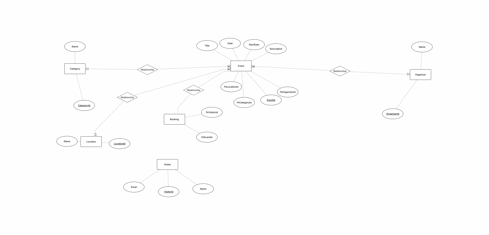

# Normalisering – från ER-modell v1 till v2

## Avgränsning och underlag
- Team: TeamAgil
- Vald del av projektet: Databas struktur
- Tabeller som granskas: Event, Organizer, Booking, Category, Location, Visitor
- Antaganden och verksamhetsregler: 
- Före-modell v1:
  
- Efter-modell v2: <a href="https://drive.google.com/file/d/1BCKMQAAxGEbkci6k-l0Mzb0_ue2DVshf/view?usp=sharing">Databas ER v2</a>
- Exempeldata: <a href="https://drive.google.com/file/d/1BCKMQAAxGEbkci6k-l0Mzb0_ue2DVshf/view?usp=sharing">Databas ER v2</a>

## 1. Före-läge – v1
| Tabell | Vad representerar en rad? | Primärnyckel (PK) | Främmande nycklar (FK) |
| --- | --- | --- | --- |
| Event | Lista över evenemang | EventId | FkLocationId, FkCategoryId, FkOrganizerId |
| Category | Lista över Kategorier | CategoryId | Inga |
| Location | Lista över platser | LocationId | Inga |
| Visitor | Lista över besökare | VisitorId | Inga |
| Booking | Lista över bokningar | BookingId | FkEventId, FkVisitorId|
| Organizer | Lista över organisörer | OrganizerId | Inga |

### Situationer att testa
Välj minst två situationer. Ange berörda tabeller och id.
1. Byter ut event title från jazz till rock men behåller event description
2. Lägger till en ny plats och byter plats av ett event till den nya platsen

## 2. Kontroll av normalformer
### 1NF
- Kontroll: ett värde per cell, inga listor eller upprepade kolumngrupper och identifierbara rader.
- Vår bedömning och motivering: alla kolumner innehåller atomära värden och samtliga tabeller har definierade primärnycklar
- Ändring eller verifiering: Strukturella krav för 1NF är redan uppfyllda i V1

### 2NF
- Kandidatnycklar som kontrollen utgår från: Tabellerna har enkla primärnycklar (t.ex EventId för Event, BookingId för Booking, CategoryId för Category osv..)
- Finns icke-nyckelattribut som beror på bara en del av en sammansatt kandidatnyckel? Nej, eftersom att alla tabeller i v1 har enkla primärnycklar.
- Ändring eller verifiering: Modellen i v1 uppfyller 2NF eftersom att de använder enkla primärnycklar, ingen strukturförändrigkrävs

### 3NF
- Finns icke-nyckelattribut som beror på nyckeln via andra icke-nyckelattribut? Nej eftersom att i v1 så har vi delat upp Location, Category och Organizer i egna tabeller istället för att lagra dem direkt i Event tabellen.
- Ändring eller verifiering: Modellen är redan I 3NF i v2 eftersom  att alla icke attribut i tabellerna enbart beror direkt på primärnyckeln.

## 3. Efter-läge – v2
| Tabell | Vad representerar en rad? | Primärnyckel (PK) | Främmande nycklar (FK) |
| --- | --- | --- | --- |
| Event | Lista över evenemang | EventId | FkLocationId, FkCategoryId, FkOrganizerId |
| Category | Lista över Kategorier | CategoryId | Inga |
| Location | Lista över platser | LocationId | Inga |
| Visitor | Lista över besökare | VisitorId | Inga |
| Booking | Lista över bokningar | BookingId | FkEventId, FkVisitorId|
| Organizer | Lista över organisörer | OrganizerId | Inga |

### Motiverade beslut
- Vi ändrade inga grundläggande struktuer eftersom den relationella uppdelningen i v1 redan uppfyllde kraven för 3NF.
- Vi behöll Tabellerna med främmande nycklar eftersom att den effektivt förhindrar redundans.
- Kopplingarna från v1 bevaras genom FkLocationId, FkCategoryId, FkOrganizerId, FkEventId, FkVisitorId
- Samma information finns i v2-flikarna, men relationerna har kvalitetssäkrats mot eventuella redundser och normaliseringsformer.

## 4. Testresultat
Testerna görs manuellt i kalkylarket. De granskar modellen,
inte en implementerad databas eller automatiska PK/FK-regler.

| Situation och berörda id | Förväntat resultat | Resultat i v1 | Resultat i v2 | Slutsats |
| --- | --- | --- | --- | --- |
|  Byter ut event title från jazz till rock men behåller event description | Endast Titlen borde ändra utan att behöva ändra andra atributer | endast titlen ändrades och beskrivningen och allt annat behölls| endast titlen ändrades och beskrivningen och allt annat behöll| V1 fungerade redan eftesom att title Description är separata kolumner i tabellen Event  |
| Lägg till en ny plats (L3, "Malmö") och flytta event E3 dit. | en till entry i location tabellen samt att event E3 ändras från L2 till L3 | ny entry i location tabellen samt att event E3 ändras från L2 till L3 | ny entry i location tabellen samt att event E3 ändras från L2 till L3 | Förbättring i dataintegritet: Genom att använda ID-referens (L3) istället för hårdkodad text undviks stavfel och dubbelarbete. |

## 5. Sammanfattning och kvarstående frågor
- Viktigaste slutsatsen: Granskningen visar att databasstrukturen i v1/v2 redan är i 3NF och håller en god standard med tydlig separation av entiteter.
- Minskad redundans eller undvikna anomalier: Genom att använda främmande nycklar mot Location, Category och Organizer undviks upprepning av textsträngar, vilket förhindrar uppdateringsanomalier.
- Kvarstående frågor eller antaganden att kontrollera: Hur kan man smidigast ändra ett eventstitlen och dess innehåll?
